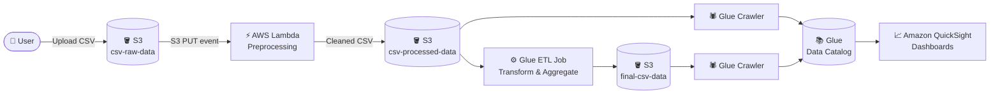

<div align="center">

# 📊 CSV Data Processing Pipeline

### Serverless, end-to-end ETL on AWS — **S3 · Lambda · Glue · QuickSight**


</div>

---

## 📌 Overview

This project implements an **end-to-end data pipeline** for processing CSV files using AWS managed services. It automates the **ingestion, preprocessing, transformation, and analysis** of CSV data, giving you processing that is efficient, scalable, and fully serverless.

> 💡 The pipeline follows the classic **Source → Transform → Store** pattern: drop a CSV in a bucket, and the data flows all the way to a dashboard.

---

## 📑 Table of Contents

- [Architecture](#-architecture)
- [Components](#-components)
- [Pipeline Execution Steps](#-pipeline-execution-steps)
- [Repository Structure](#-repository-structure)
- [Getting Started](#-getting-started)
- [Monitoring](#-monitoring)
- [Contributing](#-contributing)
- [License](#-license)

---

## 🏗️ Architecture



<!-- Optional: add your own architecture image here
<p align="center"></p>
-->

---

## 🧩 Components

| # | Service | Role in the Pipeline |
|:-:|---------|----------------------|
| 1 | 🪣 **Amazon S3** | Stores raw, processed, and final CSV data across three buckets |
| 2 | ⚡ **AWS Lambda** | Triggered on upload to `csv-raw-data`; preprocesses and cleans the data |
| 3 | 🕷️ **AWS Glue Crawler** | Infers schema and catalogs data in the **AWS Glue Data Catalog** |
| 4 | ⚙️ **AWS Glue ETL Jobs** | Performs further transformations, aggregations, and enrichment |
| 5 | 📈 **Amazon QuickSight** | Connects to the final dataset for analysis and visualization |

### 🪣 S3 Buckets

| Bucket | Purpose |
|--------|---------|
| `csv-raw-data` | Raw CSV files uploaded to start the pipeline |
| `csv-processed-data` | Preprocessed CSV data written by Lambda |
| `final-csv-data` | Final transformed data written by Glue ETL jobs |

---

## 🔄 Pipeline Execution Steps

### 1️⃣ Raw Data Upload
- Upload the raw CSV files to the **`csv-raw-data`** S3 bucket.
- The upload event **automatically triggers** the AWS Lambda function for preprocessing.

### 2️⃣ Data Preprocessing with Lambda
- The Lambda function **reads** the raw CSV files from `csv-raw-data`.
- It applies **preprocessing, cleaning, and transformations** to the CSV data (for example, filtering out rows with missing values).
- The preprocessed data is **stored** in the **`csv-processed-data`** bucket.

### 3️⃣ Data Cataloging with Glue Crawler
- The Glue Crawler **scans** `csv-processed-data` to infer the schema of the preprocessed files.
- It creates a **metadata catalog** in the AWS Glue Data Catalog, making the data discoverable and queryable.

### 4️⃣ Data Transformation with Glue ETL
- Glue ETL jobs **read** the preprocessed data from `csv-processed-data`.
- They perform **additional transformations, aggregations, and data enrichment** based on business requirements.
- The transformed data is **written** to the **`final-csv-data`** bucket.

### 5️⃣ Data Catalog Update
- The Glue Crawler **scans** `final-csv-data` to update the metadata catalog.
- This ensures the catalog **reflects the structure** of the final transformed data.

### 6️⃣ Data Visualization with QuickSight
- Amazon QuickSight **connects** to the final dataset through the AWS Glue Data Catalog.
- Build **interactive dashboards, reports, and visualizations** on the processed data.
- Explore, analyze, and **share insights** across your team.

---

## 📁 Repository Structure

```
📦 Data-Pipeline-for-Processing-CSV-Files-Using-S3-Lambda-Glue
 ┣ 📜 CSVPreprocessorFunction.zip        # Lambda deployment package
 ┃ ┣ 📂 src/lambda_function.py           #   ↳ Python preprocessing handler
 ┃ ┗ 📄 template.yaml                    #   ↳ AWS SAM / CloudFormation template
 ┣ 📊 weather_data.csv                   # Sample raw input (hourly weather data)
 ┣ 📊 run-1792270295351-part-r-00000.csv # Sample final output from the Glue ETL job
 ┣ 🧾 manifest.json                      # QuickSight S3 manifest pointing to the final data
 ┗ 📘 README.md
```

### ⚡ Lambda Function at a Glance

| Setting | Value |
|---------|-------|
| Runtime | Python (`lambda_function.lambda_handler`) |
| Trigger | `s3:ObjectCreated:*` on keys with prefix **`raw/`** and suffix **`.csv`** |
| Logic | Reads the CSV, drops rows with empty values, keeps the header |
| Output | Writes the cleaned file to the processed bucket, swapping `raw/` → `processed/` in the key |

---

## 🚀 Getting Started

### ✅ Prerequisites

- An **AWS account** with permissions for S3, Lambda, Glue, IAM, and QuickSight
- **AWS CLI** installed and configured (`aws configure`)
- **Git**

### 🛠️ Setup

**1. Clone the repository**

```bash
git clone https://github.com/samdreal/Data-Pipeline-for-Processing-CSV-Files-Using-S3-Lambda-Glue.git
cd Data-Pipeline-for-Processing-CSV-Files-Using-S3-Lambda-Glue
```

**2. Deploy the AWS resources**

Use the AWS SAM / CloudFormation template (`template.yaml`, inside `CSVPreprocessorFunction.zip`) or the AWS CLI to create the required resources.

```bash
unzip CSVPreprocessorFunction.zip -d CSVPreprocessorFunction
cd CSVPreprocessorFunction
sam deploy --guided
```

**3. Configure the services**

Configure the S3 buckets, Lambda function, Glue Crawler, Glue ETL jobs, and QuickSight to fit your requirements.

**4. Trigger the pipeline**

Upload a raw CSV file to the `raw/` folder of the `csv-raw-data` bucket (the Lambda trigger only fires for `raw/*.csv`):

```bash
aws s3 cp weather_data.csv s3://csv-raw-data/raw/
```

**5. Monitor the run**

Track progress in **Amazon CloudWatch** and the **Glue job logs**.

**6. Visualize the results**

Open **Amazon QuickSight**, create an **S3 dataset** using `manifest.json` (update the URI to your final bucket), and build your dashboards. 🎉

---

## 📡 Monitoring

| What to check | Where |
|---------------|-------|
| Lambda invocations & errors | CloudWatch → Log groups → `/aws/lambda/<function-name>` |
| Crawler runs | AWS Glue → Crawlers → Run history |
| ETL job status & logs | AWS Glue → ETL jobs → Runs |
| Catalog tables | AWS Glue → Data Catalog → Tables |

---

## 🤝 Contributing

Contributions are welcome! 🙌

1. **Fork** the repository
2. **Create** a feature branch: `git checkout -b feature/my-improvement`
3. **Commit** your changes: `git commit -m "Add my improvement"`
4. **Push** the branch: `git push origin feature/my-improvement`
5. **Open** a Pull Request

Found a bug or have an idea? Please [open an issue](../../issues).

---

## 📄 License

This project is licensed under the **MIT License**.

---

<div align="center">

⭐ **If you found this project helpful, please give it a star!** ⭐

</div>
